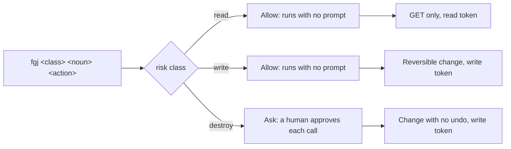
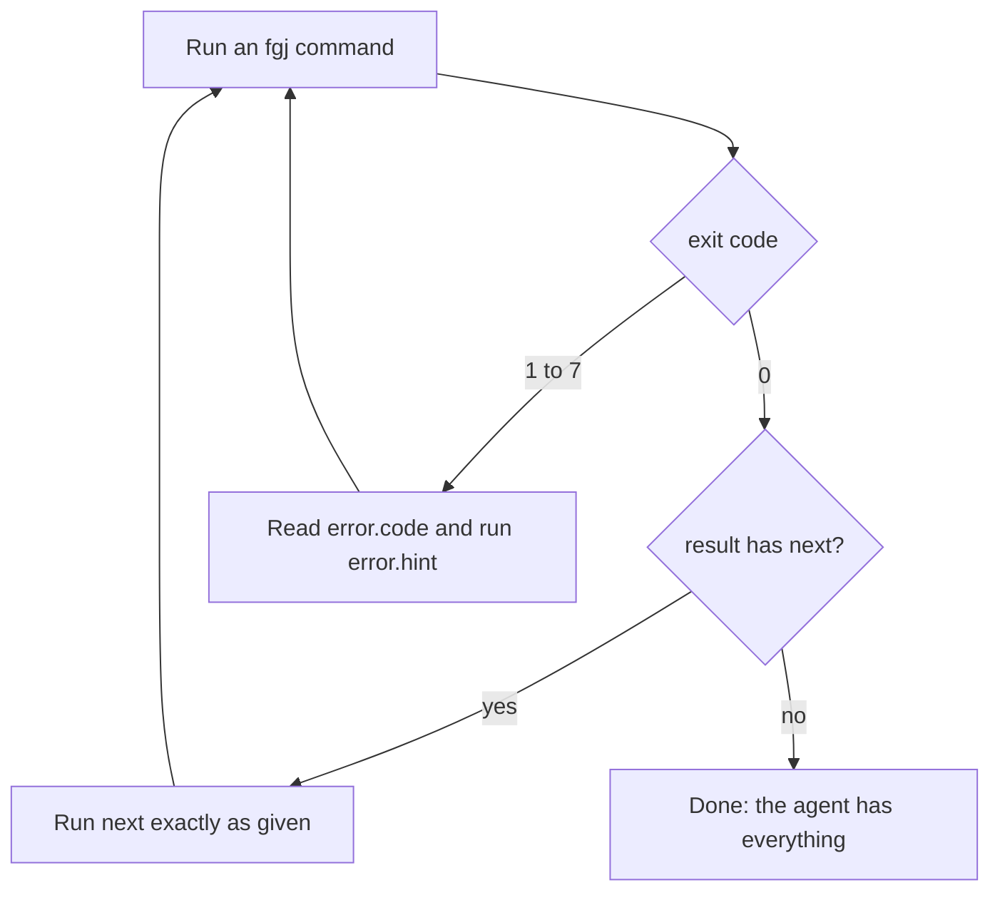
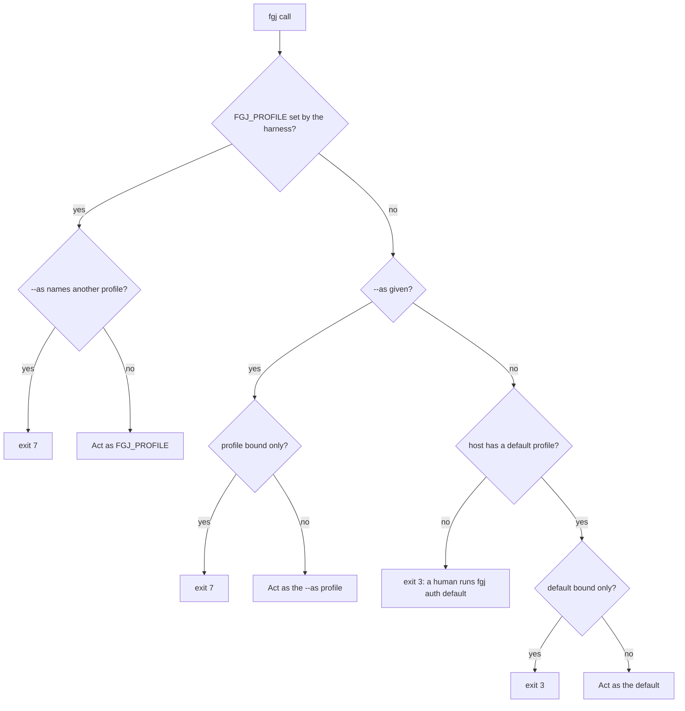

<p align="center"></p>

# fgj

The Forgejo CLI that helps agent teams make Forgejo their source of truth.
Agents run it. Humans evaluate it, set it up, and approve the calls that cannot be undone.

```sh
$ fgj read issue get 157 --fields number,title,state,labels
{"number":157,"title":"Login fails after a password reset","state":"open","labels":["type/bug","priority/p1"],"as":"team-lead"}
```

Each command is one plain line that an agent harness can allow by its first two words.
Each result is one line of compact JSON that names the Forgejo account that acted.

| Reader | Reads | To |
|---|---|---|
| A human who evaluates fgj | This README, [`docs/design.md`](docs/design.md) | Decide whether fgj fits, and how it keeps agents in bounds. |
| A human who runs it | [Get started](#get-started) | Store one account per agent role, and install the harness rules. |
| An agent | `fgj help`, the [agent skill](skill/fgj/SKILL.md) | Find the command, write the call, and read the result. |

Status: early, and in daily use by a team of agents. The tests run against Forgejo
16.0.5. The 0.1.0 npm candidate is a local tarball, not a registry release.

<!-- getting-started:start -->
## Get started

Use Bun **1.3.14**, Git, Claude Code and one Forgejo account for your agent.
The candidate supports macOS arm64 and Linux arm64, not Windows or other architectures.
Put Bun and its global binary directory on PATH. `bun pm bin -g` shows the global directory.

1. Install the reviewed `fgj-0.1.0.tgz` supplied by your maintainer:

   ```sh
   bun add --global --ignore-scripts "$PWD/fgj-0.1.0.tgz"
   fgj help
   ```

2. Store the agent account's tokens at a human terminal:

   ```sh
   fgj auth --profile agent https://your-forgejo.example
   ```

   Create a read token and a write token for that account. fgj shows the token page and required scopes.
   Approve the default only if every unbound agent on that host can use this account.
   The following read uses that approved default. Without a default, configure a harness binding first.

3. Install the Claude Code permission rules. Review and approve the displayed change:

   ```sh
   fgj rules install claude
   ```

4. Install the Claude Code skill. Review and approve the displayed change:

   ```sh
   fgj skill install claude
   ```

5. Replace `owner/repository` with your Forgejo repository and make a first read:

   ```sh
   fgj read issue list --repo owner/repository
   ```

Start a new Claude Code session in your repository after setup.
For Codex, replace `claude` with `codex` in the two install commands. The other steps stay the same.
Board commands and Actions reruns need an additional web login, not a source build.

Installation, help and version work without Git. Auth and network commands require Git on PATH.
No source checkout is required. The package has no npm runtime dependencies.
The candidate has no lifecycle scripts and does not install Git hooks or harness rules automatically.
The executable ignores ambient `.env` files and Bun preload configuration.
<!-- getting-started:end -->

See [additional setup](docs/setup.md) for pi, account bindings, web login and npm/npx alternatives.
See [release constraints](docs/release.md) for maintainer builds and release approval.

## Why fgj exists

An agent can reach Forgejo in several ways: a CLI such as
[tea](https://gitea.com/gitea/tea) or [fj](https://codeberg.org/forgejo-contrib/forgejo-cli),
an MCP server, curl on the REST API, or browser automation on the web UI. Each one meets
the same problems:

- **Approvals.** A harness rule matches command text. When one command can read or
  delete, the rule cannot tell the two apart, so a human approves calls one by one, or
  allows too much.
- **Context cost.** A raw Forgejo issue has about 800 tokens of metadata before its body.
  Every call fills the model's context.
- **Identity.** Most tools act with one token. Agents that share it act as one account,
  with all its rights.
- **API gaps.** Forgejo 16 has no REST API for project boards or for re-running Actions,
  and some answers mislead a client. [`docs/design.md`](docs/design.md) lists each gap with
  its source.

A broad rule for `tea api` permits both GET and DELETE requests. A pipeline can also
hide the request behind shell syntax that a harness cannot split safely.

fgj separates reads into plain commands with an explicit risk class:

```sh
fgj read issue get ISSUE
fgj read comment list ISSUE
```

Replace `ISSUE` with a synthetic test issue number or your intended target.

Each returns compact JSON, with about 100 tokens of metadata for an issue. fgj is not
the only Forgejo tool for agents; [`docs/design.md`](docs/design.md) compares the others
and says what fgj adds: a safety model and small output, not wider coverage.

## How it works

### The risk class is the first word

The grammar is `fgj <read|write|destroy> <noun> <action> <args> [--flags]`. No flag or
alias comes before the risk class, so one harness rule covers each class.



| Class | What it does | Token | Harness rule | Examples |
|---|---|---|---|---|
| `read` | Sends GET requests only. | read (the web session for board reads) | allow | `issue get`, `run log`, `status wait` |
| `write` | Makes a change that a later call can reverse. | write | allow | `comment add`, `issue close`, `pr create` |
| `destroy` | Makes a change with no undo. | write | ask | `comment delete`, `pr merge` |

fgj checks the class against the verb before it sends a request. A call with the wrong
class fails, and the hint is the corrected command:

```sh
$ fgj read comment delete 770
{"error":{"code":"risk_mismatch","message":"comment delete is a destroy verb, but the command says read.","hint":"fgj destroy comment delete 770"}}
```

`fgj rules install <harness>` writes these rules for Codex, Claude Code, and pi. For
example, the Claude Code rules:

```json
{
  "allow": ["Bash(fgj read *)", "Bash(fgj write *)", "Bash(fgj help *)", "Bash(fgj auth status *)",
            "Bash(fgj rules show *)", "Bash(fgj rules status *)", "Bash(fgj skill show *)", "Bash(fgj skill status *)"],
  "ask": ["Bash(fgj destroy *)", "Bash(fgj auth default *)", "Bash(fgj auth remove *)"]
}
```

No argument needs a shell metacharacter. A body comes from a file (`--body-file`), never
from an argument, so quotes and new lines in a body never need shell quoting, and the
command stays plain enough for the rule to match.

### The agent loop

stdout holds one JSON object. stderr holds `{error:{code,message,hint}}`, and the hint is
a runnable command. When fgj knows the account, the error also names it in `as`. An agent can follow fgj from one call to the next with no
documentation open:



A list that has more items gives the command for the next page:

```sh
$ fgj read comment list 157 --limit 1 --fields id,author
{"items":[{"id":768,"author":"team.lead"}],"total":4,"next":"fgj read comment list 157 --limit 1 --offset 1 --fields id,author","as":"team-lead"}
```

A write returns `changed`. `changed:false` means the change is already there, so a retry
is safe and posts nothing. Each `destroy` verb takes `--dry-run`, which shows the plan
and the exact command to apply it.

| Exit | Code | Meaning |
|---|---|---|
| 0 | | The call worked. |
| 1 | `api` | The server refused the request or failed, or the network failed. |
| 2 | `usage` | The command is wrong. fgj made no change. |
| 3 | `auth` | No usable profile or token, or the account has no access. |
| 4 | `not_found` | The target does not exist. |
| 5 | `conflict` | The target's state blocks the change, for example another author's comment. |
| 6 | `risk_mismatch` | The risk class is wrong. The hint has the correct one. |
| 7 | `identity_mismatch` | The call asks for an account that it cannot use. |

### One account per agent role

Each agent role acts as its own Forgejo account, through a named profile. A profile holds
a read token and a write token, and optionally a web session for the verbs that Forgejo
has no API for. Every result names the profile that acted in `as`.



The diagram leaves out two cases. A profile that is unknown, or stored for another host,
gives exit 3. With no profile stored for the host, `FGJ_URL` with `FGJ_READ_TOKEN` and
`FGJ_WRITE_TOKEN` acts as `env`.

A profile marked bound only (`fgj auth bound <profile> on`) acts only through
`FGJ_PROFILE`. An agent cannot reach it with `--as` or through the default, so it cannot
pick another lane's account by itself.

## Verbs

`fgj help` lists every verb. `fgj help <noun> <action>`, or `--help` on any call, shows
the arguments, flags, fields, output, examples, and notes. Help sends no request.

<!-- verbs:start: bun run docs:verbs writes this table from the manifest -->
| Command | What it does |
|---|---|
| `fgj read comment list <issue>` | List the comments on an issue or pull request, oldest first. |
| `fgj read comment get <comment>` | Read one comment, with its whole body. |
| `fgj write comment add <issue> --body-file PATH` | Add a comment from a file. A repeat of your latest comment returns changed:false. |
| `fgj write comment edit <comment> --body-file PATH` | Replace the body of your own comment from a file. The same body returns changed:false. |
| `fgj write comment attach <comment> --file PATH` | Upload a text file to your own comment. The same file again returns changed:false. |
| `fgj destroy comment delete <comment>` | Delete your own comment. A missing comment returns changed:false. No undo. |
| `fgj read issue get <issue...>` | Read one or many issues or pull requests: title, state, labels, and body. |
| `fgj read issue list` | List the repository's issues, newest first. Filter by state, labels, and words. |
| `fgj write issue create --title TEXT` | Open an issue. A repeat of your latest issue returns changed:false with its number. |
| `fgj write issue edit <issue...>` | Change the title, body, labels, or milestone of one or many issues. What is already so returns changed:false. |
| `fgj write issue close <issue...>` | Close one or many issues. One already closed returns changed:false. |
| `fgj write issue reopen <issue...>` | Reopen one or many issues. One already open returns changed:false. |
| `fgj write dep add <issue> <on...>` | Make an issue depend on one or many issues. An existing dependency returns changed:false. |
| `fgj write dep remove <issue> <on...>` | Make an issue stop depending on one or many issues. One that is not a dependency returns changed:false. |
| `fgj read label list` | List the repository's labels by name, and which are exclusive. |
| `fgj write label create --name NAME --color RRGGBB` | Add a label to the repository. The same label again returns changed:false. |
| `fgj write label edit <label>` | Change a label's color, description, or exclusivity. What is already so returns changed:false. |
| `fgj read milestone list` | List the repository's milestones with their ids and open and closed issue counts. |
| `fgj write milestone create --title TEXT` | Add an open milestone with no deadline. The same milestone again returns changed:false. |
| `fgj write milestone edit <milestone>` | Change a milestone's title or description. What is already so returns changed:false. |
| `fgj write milestone close <milestone>` | Close a milestone. One already closed returns changed:false. |
| `fgj write milestone reopen <milestone>` | Reopen a milestone. One already open returns changed:false. |
| `fgj read pr get <pr...>` | Read one or many pull requests: state, draft, mergeable, branches, head SHA, and body. |
| `fgj read pr list` | List pull requests, newest first. Filter by state, base, author, and label. |
| `fgj write pr create --title TEXT` | Open a pull request from a branch. A repeat returns the open PR for the same head and base with changed:false. |
| `fgj write pr edit <pr>` | Change a pull request's title, body, or draft state. What is already so returns changed:false. |
| `fgj write pr close <pr...>` | Close one or many pull requests. One already closed returns changed:false. |
| `fgj write pr reopen <pr...>` | Reopen one or many pull requests. One already open returns changed:false. |
| `fgj destroy pr merge <pr>` | Merge a pull request with a named style, pinned to its head. A merged PR returns changed:false. No undo. |
| `fgj read status get <ref>` | Read the checks of a commit: the state, and one entry per check with its Actions run. |
| `fgj read status wait <ref>` | Wait up to 90 s for a commit's checks; pending gives next. |
| `fgj read run get <run>` | Read an Actions run: status, jobs, and for a failure the lines that explain it. |
| `fgj read run log <run>` | Read part of an Actions job log: error lines, lines that match a text, or the last lines. |
| `fgj write run rerun <run>` | Re-run a finished Actions run, or one job, on the same head. |
| `fgj read run wait <run>` | Wait up to 90 s for an Actions run; pending gives next. |
| `fgj read board list` | Read a project board: each column and the issue numbers of its cards, in board order. |
| `fgj read board card <issue...>` | Find the project and the board column of one or many issues. |
| `fgj write board create <name>` | Create a repository board, or reuse its unique open name match. |
| `fgj write board add <issue...>` | Add one or many issues to a repository project, optionally into a column. |
| `fgj write board move <issue...> --column NAME` | Move the cards of one or many issues to a column of their project. |
| `fgj read api get <repo-relative-path>` | Read a repository GET endpoint that no verb covers, as compact JSON. |
<!-- verbs:end -->

The board verbs, `board list` and `board card` among them, and `run rerun` use the
Forgejo web pages, because Forgejo has no API for them. fgj sends only its own defined
web operations. It has no raw browser or `eval` passthrough. `api get` reads a
repository GET endpoint that no verb covers.

The setup commands, `fgj auth`, `fgj rules`, and `fgj skill`, have their own help pages:
`fgj help auth`, `fgj help rules`, and `fgj help skill`. An agent can run only their
`status` and `show` forms. A human runs the others at a terminal.

## Ownership model

### fgj owns the mechanism, teams own the policy

fgj owns:

- the `fgj` binary: the grammar, the risk check, the Forgejo REST client, and the defined
  web operations for features with no REST endpoint, such as project boards;
- the permission rules that it generates for each supported harness;
- the generic agent skill and the help manifest.

fgj does not own any team's workflow. It has no idea of a ticket lifecycle, a review
policy, or a branch rule. A team writes those in its own skills and role prompts, which
compose fgj commands.

### Each agent owns its actions

- A human creates one profile per agent role, and binds each role to its profile in the
  harness. A binding wins over the host's default.
- `comment edit`, `comment attach`, and `comment delete` change only the caller's own
  comments. Another author's comment gives `conflict`.
- A human approves each `destroy` call. In pi, the fgj adapter asks before the call and
  gives the approved call a one-time approval. With no human to answer, it blocks the call.
- Only a human runs `fgj auth` (except `status`), `fgj rules install`, and
  `fgj skill install`. They need a terminal, and they fail when an agent runs them.


## Develop

Start with [CONTRIBUTING.md](CONTRIBUTING.md) for a source-development path and one complete local check.
No development step requires a global fgj installation.
Read [SECURITY.md](SECURITY.md) before reporting a vulnerability.

Each directory has a guide that says what it owns:

- [`src/`](src/README.md): the `fgj` binary.
- [`skill/`](skill/README.md): the generic fgj agent skill.
- [`test/`](test/README.md): unit, real-server, and harness tests.
- [`scripts/`](scripts/README.md): developer and CI tooling: the test server, the checks, and the build.
- [`docs/`](docs/README.md): the design and the harness check guide.
- [`.github/`](.github/overview.md): public GitHub CI and its security boundaries.
- [`.githooks/`](.githooks/README.md): the pre-commit hook.
- [`assets/`](assets/README.md): the logo files that the documentation shows.

## AI assistance

This codebase was developed with the help of AI.

## License

Licensed under either of [Apache License, Version 2.0](LICENSE-APACHE) or
[MIT license](LICENSE-MIT), at your option.
